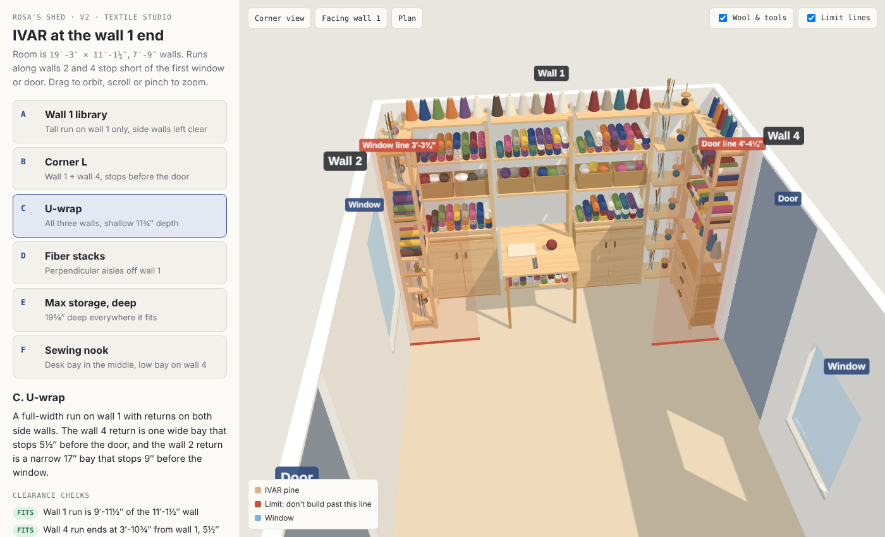

# Rosa's Shed — IVAR Layout Viewer

This is an interactive 3D viewer for comparing IKEA IVAR shelving layouts at the
wall 1 end of Rosa's textile studio shed.



## Quick start

You need Node 18 or newer.

```bash
npm install
npm run dev
```

Then open http://localhost:5173. Add `#A` through `#F` to the URL to jump to a layout.

## What's here

- **6 layouts** (A–F) along wall 1 and along walls 2 and 4, with a freestanding
  peninsula in layout D.
- **Automatic clearance checks.** Runs on walls 2 and 4 must stop before the first
  door or window on that wall.
- **A parts list** for each layout (side units, shelves, cabinets, drawers, folding
  table, cross-braces).
- **Textile-studio contents** you can toggle on and off: wool skeins, yarn cones,
  baskets of yarn and roving, and tool jars.

## Working on it with Claude Code

Open this folder in a terminal and run `claude`. `CLAUDE.md` gives Claude the room
measurements, the design rules and a code map. Some things you can ask for:

- "Add a layout G with a deep 70½″ run on wall 1 and a narrow bay on wall 2."
- "Let me drag runs along the wall and re-check clearances live."
- "Add IKEA prices and a total to the parts list."

After changing layouts, run `npm run check` to confirm everything still fits.

## Files

- `src/data/` holds the room, the IVAR catalog sizes and the layouts. This is where
  most edits happen.
- `src/scene/` holds the three.js building code.
- `reference/` holds the original SketchUp file, the first single-file viewer, and
  screenshots.
- `tools/` holds the layout checker and the SketchUp geometry extractor.
